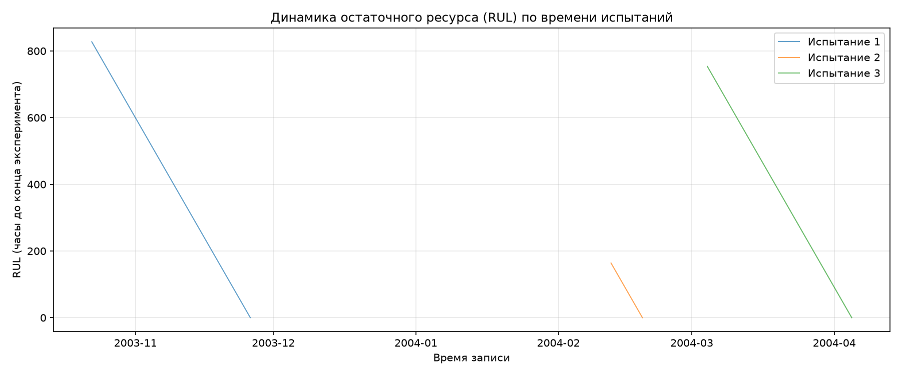
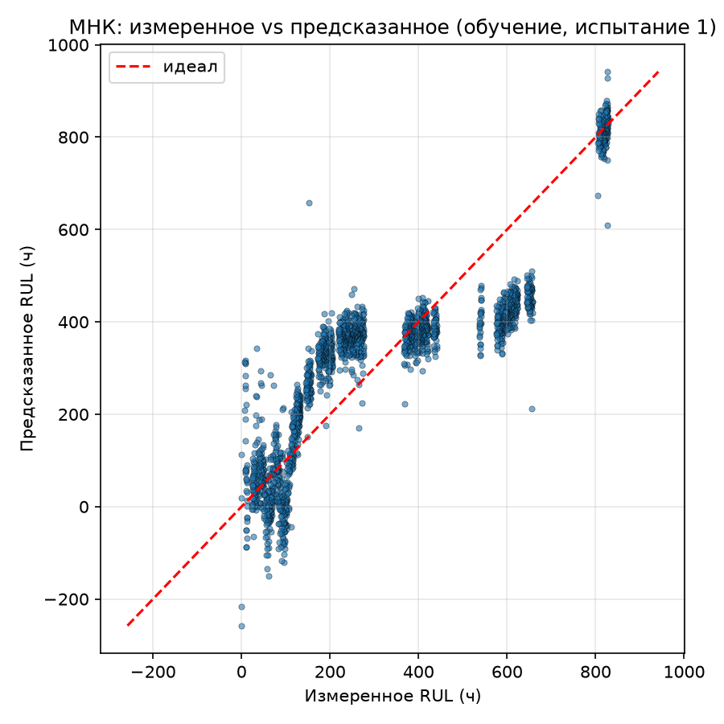
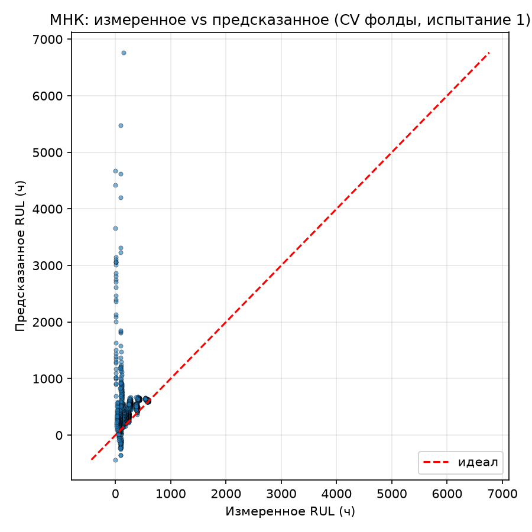
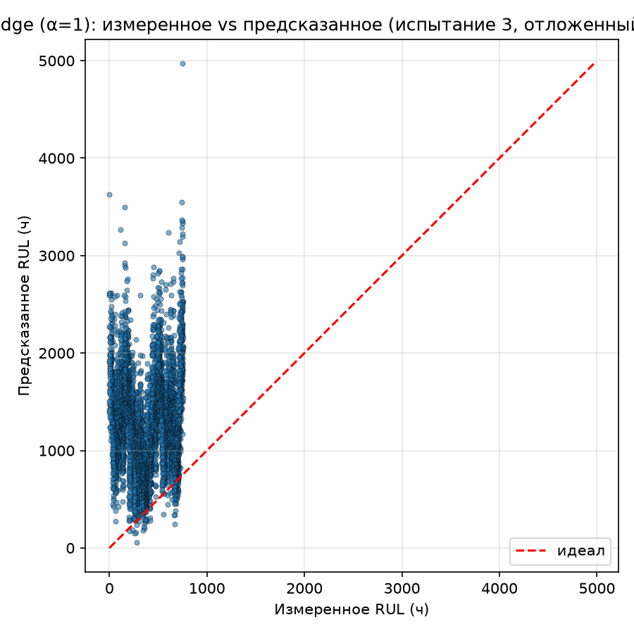
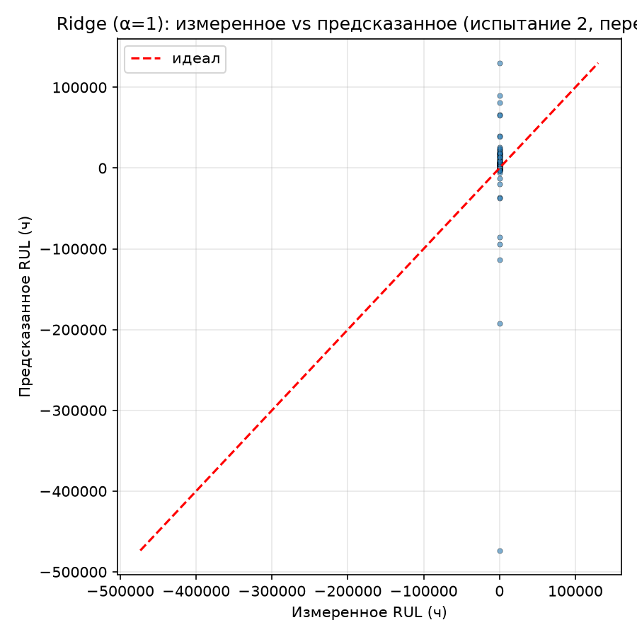
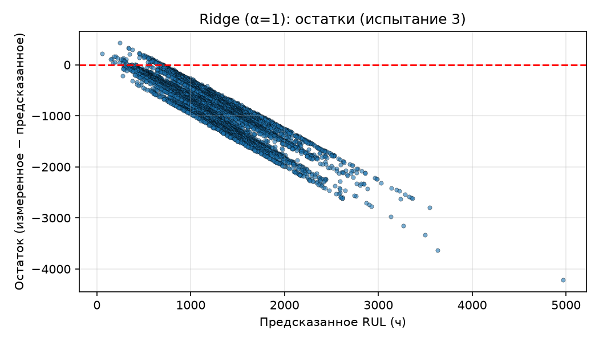
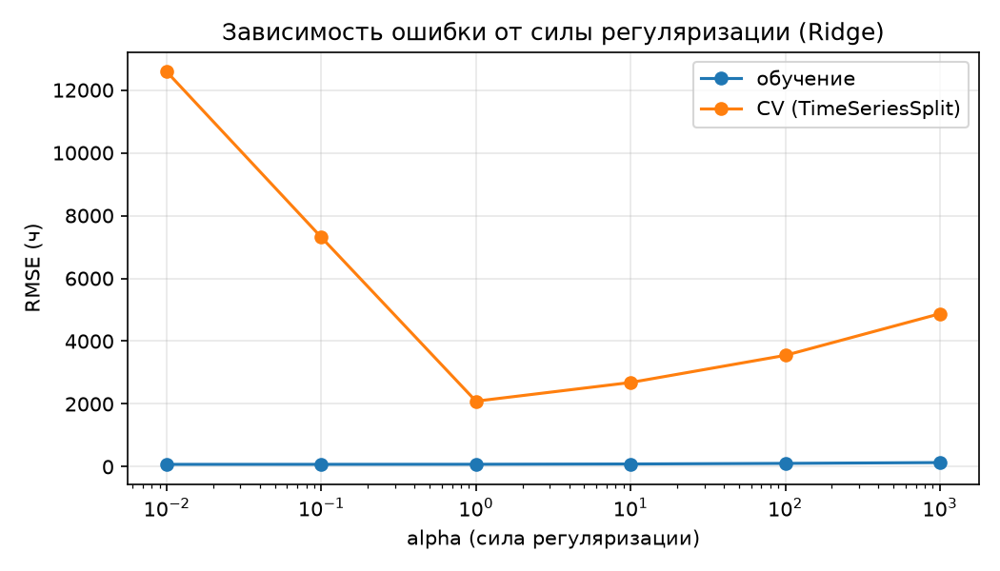

# Задача 1 (регрессия), вариант 13 — Деградация подшипника

Вариант: **13 — Деградация подшипника**  
Источник данных: **NASA IMS Bearing Dataset** (Center for Intelligent Maintenance Systems, University of Cincinnati)

---

## 1. Постановка задачи

По последовательности вибрационных записей испытания подшипника до отказа оценить **время, остающееся до конца эксперимента (RUL — остаточный полезный срок службы)**. Целевая величина — построенная прокси-величина, а не непосредственно измеренный истинный остаточный ресурс.

Модель должна быть **линейной по оцениваемым коэффициентам**:
ŷ = β₀ + Σⱼ βⱼ·φⱼ(x)

Нелинейность допускается только в преобразованных признаках φⱼ(x).

---

## 2. Описание набора данных

Набор **NASA IMS Bearing Dataset** содержит три испытания «до отказа» (test-to-failure) подшипников Rexnord ZA-2115 (двойные радиальные шариковые подшипники) на стенде с постоянной частотой вращения 2000 об/мин и радиальной нагрузкой 6000 lbs. Подшипники смазываются под давлением.

| Испытание | Период записи | Количество файлов | Каналов | Неисправность в конце |
|-----------|---------------|-------------------|---------|------------------------|
| 1 | 22.10.2003 – 25.11.2003 | 2156 | 8 | inner race defect (подшипник 3), roller element defect (подшипник 4) |
| 2 | 12.02.2004 – 19.02.2004 | 984 | 4 | outer race failure (подшипник 1) |
| 3 | 04.03.2004 – 04.04.2004 | 4448 | 4 | outer race failure (подшипник 3) |

- Каждый файл — **1-секундный снимок вибрации**, 20 480 отсчётов, частота дискретизации **fs = 20 кГц**.
- Формат: ASCII, табуляция, каждая строка — один отсчёт.
- Имя файла указывает время сбора (гггг.мм.дд.чч.мм.сс).
- Всего обработано **7588 записей** (после удаления записей с отрицательным RUL).

**Целевая переменная:** RUL (остаток времени до конца эксперимента, часы), вычисляется как разница между временем окончания испытания (из Readme) и временем записи файла. Диапазон: 0 … ~827.6 ч.

**Входные переменные:** вибрационный сигнал с датчиков ускорения (акселерометров PCB 353B33), установленных на корпусе подшипника (ось X и/или Y). Единица измерения сигнала — ускорение (g).

---

## 3. Физические гипотезы (сформулированы ДО обучения)

1. **Гипотеза H1 (рост общей вибрации):** По мере износа подшипника и развития дефекта дорожки качения общий уровень вибрации (RMS сигнала) монотонно растёт, так как удары телкающихся тел о дефект становятся сильнее и чаще.
2. **Гипотеза H2 (рост высокочастотной энергии):** Дефект подшипника порождает кратковременные импульсы с высокочастотным содержимым, поэтому энергия в высокочастотной полосе (4–10 кГц) систематически возрастает по мере приближения к отказу, в то время как низкочастотная часть спектра изменяется слабее.

---

## 4. Признаки

Для каждой записи вычислены (усреднённые по всем каналам записи):

| Признак | Описание |
|---------|----------|
| `rms` | Среднеквадратичное значение вибрации |
| `var` | Дисперсия сигнала |
| `kurt` | Эксцесс (kurtosis) — острота вершины распределения, растёт при импульсных ударах |
| `crest` | Пик-фактор (пик / RMS) |
| `band_0_500` | Энергия в полосе 0–500 Гц |
| `band_500_1000` | Энергия в полосе 500–1000 Гц |
| `band_1000_2000` | Энергия в полосе 1–2 кГц |
| `band_2000_4000` | Энергия в полосе 2–4 кГц |
| `band_4000_10000` | Энергия в полосе 4–10 кГц |

**Запрещённые признаки (согласно варианту):** номер записи, абсолютное время и вычисленное время до конца эксперимента не используются как входные признаки.

Физически мотивированный поднабор для интерпретируемой модели: `rms` (общий уровень вибрации) + `band_4000_10000` (высокочастотная энергия, растёт при износе).

---

## 5. Разбиение данных (только временное)

Согласно требованию варианта 13, используется **только временное разбиение**. Одно испытание полностью откладывается:

- **Испытание 1** (октябрь–ноябрь 2003) — обучение + кросс-валидация по времени (`TimeSeriesSplit`, 5 фолдов).
- **Испытание 2** (февраль 2004) — отложенное испытание, проверка переноса между экспериментами.
- **Испытание 3** (март–апрель 2004) — полностью отложенный объект, финальная проверка (внешняя отложенная оценка).

Тестовые выборки не используются ни для подбора признаков, ни для настройки гиперпараметров.

---

## 6. Построенные модели

1. **Базовая модель** — константа (среднее RUL по обучающей части испытания 1).
2. **МНК** — обычная линейная регрессия (степень 1) на всех 9 признаках.
3. **Физически мотивированная линейная постановка** — линейная регрессия на 2 признаках (`rms`, `band_4000_10000`).
4. **Полиномиальная регрессия 2-й степени** — на всех 9 признаках с взаимодействиями и квадратами.
5. **Ridge (гребневая регрессия)** — полином 2-й степени + L2-регуляризация, подбор α по CV.
6. **Lasso (L1-регуляризация)** — полином 2-й степени + L1-регуляризация, подбор α по CV.

Все конвейеры: `StandardScaler` → (`PolynomialFeatures(degree=2)`) → линейная модель. Стандартизация и построение признаков выполняются **внутри конвейера**, отдельно для каждого фолда кросс-валидации. Коэффициенты регуляризации подбираются только по обучающей части с CV.

---

## 7. Метрики качества (MAE / RMSE / R², часы)

| Модель | Обучающая MAE | Обучающая RMSE | Обучающая R² | CV MAE | CV RMSE | CV R² | Тест 2 (перенос) MAE | Тест 2 RMSE | Тест 3 (отложенный объект) MAE | Тест 3 RMSE | Тест 3 R² |
|--------|---------------|----------------|--------------|--------|---------|-------|----------------------|-------------|--------------------------------|-------------|-----------|
| Базовая (константа) | 201.92 | 235.10 | 0.000 | 201.92 | 235.10 | 0.000 | 235.82 | 240.53 | 194.19 | 226.61 | -0.072 |
| МНК (линейная) | 95.32 | 116.48 | 0.755 | 244.34 | 408.96 | -511.47 | 1366.05 | 1549.65 | 941.81 | 970.75 | -18.67 |
| Физически мотивированная | 119.77 | 145.02 | 0.619 | 190.53 | 219.96 | -75.36 | 1662.05 | 1687.14 | 1749.52 | 1763.43 | -63.92 |
| Полином 2-й степени | 55.83 | 74.54 | 0.899 | 1433.18 | 9328.63 | -730761.88 | 5429.80 | 22079.10 | 6418.03 | 6470.91 | -873.16 |
| Ridge (α=1) | 57.63 | 77.52 | 0.891 | 648.10 | 2087.70 | -22100.13 | 3732.20 | 18796.91 | 925.10 | 1067.44 | -22.79 |
| Lasso (α=1) | 73.25 | 92.01 | 0.847 | 531.73 | 1707.68 | -15472.39 | 1297.99 | 5069.04 | 313.36 | 378.21 | -1.99 |

*Подбор α:* Ridge и Lasso выбирали по TimeSeriesSplit CV на обучающем наборе (испытание 1) среди α = {0.01, 0.1, 1, 10, 100, 1000} (Ridge) и {0.001, 0.01, 0.1, 1, 10} (Lasso); оптимум — α = 1.

---

## 8. Зависимость ошибки от силы регуляризации

Построен график зависимости RMSE от α для Ridge (файл `figure/ridge_validation_curve.png`). С ростом α ошибка на обучении растёт медленно, ошибка валидации сначала падает, затем растёт — оптимум в районе α ≈ 1. Это подтверждает необходимость регуляризации и отсутствие недообучения при α = 1.

---

## 9. Графики


### 9.1 История RUL во времени для трёх испытаний




### 9.2 «Измеренное vs предсказанное» для МНК (обучение, испытание 1)




### 9.3 «Измеренное vs предсказанное» для МНК (CV-фолды, испытание 1)




### 9.4 «Измеренное vs предсказанное» для Ridge на отложенном объекте (испытание 3)




### 9.5 «Измеренное vs предсказанное» для Ridge (перенос, испытание 2)




### 9.6 График остатков Ridge на испытании 3




### 9.7 Зависимость RMSE от силы регуляризации α (Ridge)



---

## 10. Устойчивость коэффициентов (бутстрэп, 200 повторений, OLS на испытании 1)

| Признак | coef_mean | coef_std | coef_min | coef_max | Знак стабилен |
|---------|-----------|----------|----------|----------|---------------|
| rms | -18.18 | 179.27 | -151.84 | 948.13 | Нет |
| var | 670.61 | 525.83 | -843.83 | 2504.94 | Нет |
| kurt | 70.46 | 8.68 | 49.73 | 98.28 | Да (+) |
| crest | -80.88 | 7.76 | -104.87 | -60.48 | Да (−) |
| band_0_500 | -72.50 | 69.86 | -452.16 | -12.25 | Да (−) |
| band_500_1000 | 92.79 | 39.70 | -13.33 | 255.45 | Нет |
| band_1000_2000 | -140.92 | 53.23 | -398.59 | -50.84 | Да (−) |
| band_2000_4000 | -460.46 | 187.06 | -1275.08 | -116.24 | Да (−) |
| band_4000_10000 | -233.79 | 284.59 | -1523.16 | 275.67 | Нет |

Коэффициенты при эксцессе (`kurt`), пик-факторе (`crest`) и полосах 0–500, 1–2, 2–4 кГц сохраняют знак при бутстрэпе — устойчивы. Коэффициенты при `rms`, `var`, `band_500_1000`, `band_4000_10000` меняют знак — чувствительны к коррелированным признакам (мультиколлинеарность), что ожидаемо для спектральной энергии соседних полос.

---

## 11. Проверка на отложенном объекте (испытание 3) и интерполяционная оценка

- **Интерполяционная оценка (обучение + CV на испытании 1):** Ridge даёт на CV RMSE ≈ 2088 ч при диапазоне RUL 0–827 ч — модель не обобщается даже внутри одного испытания при временном разделении (экстраполяция по времени от ранних записей к поздним).
- **Отложенный объект (испытание 3):** Ridge MAE ≈ 925 ч, RMSE ≈ 1067 ч, R² ≈ −22.8. Это существенно хуже обучающей оценки (MAE 57.6, RMSE 77.5), что указывает на **сильное переобучение** полиномиальных и регуляризованных моделей к специфике первого испытания и отсутствие переноса на другие испытания.
- **Перенос между испытаниями (испытание 2):** ошибки ещё выше (MAE 3732 ч), что подтверждает низкую обобщающую способность между разными экспериментами.

Лучшая по отложенному объекту модель — **Lasso (α=1)** на испытании 3: MAE ≈ 313 ч, RMSE ≈ 378 ч, R² ≈ −2.0 (все ещё отрицательный, но ближе к нулю, чем у остальных).

---

## 12. Выводы (недообучение / переобучение)

1. **Базовая модель (константа)** — недообучает (R² = 0), служит эталоном.
2. **МНК** — показывает качество на обучении (R² = 0.75), но на CV и тестах резко ухудшается — признак переобучения и нестационарности данных.
3. **Полином 2-й степени** — лучшее обучающее качество (R² = 0.90), но катастрофическая обобщающая способность (CV RMSE ~9328) — **явное переобучение** из-за большого числа взаимодействий при ограниченном объёме данных.
4. **Ridge/Lasso** — сглаживают переобучение по сравнению с полиномом, обучающее качество близко к МНК, но CV и тестовые ошибки всё ещё высоки. Регуляризация α = 1 оптимальна по CV.
5. **Межэкспериментальный перенос отсутствует:** модель, построенная на испытании 1, не предсказывает RUL на испытаниях 2 и 3. Это ожидаемо для задачи оценки остаточного ресурса по вибрации без калибровки под конкретный подшипник/эксперимент.

**Рекомендация:** для практического применения необходимы больше испытаний для обучения, дополнительные признаки (частотные гармоники подшипника, envelop-анализ) и/или адаптация модели под конкретный объект.

---

## 13. Структура архива `st117207_1.zip`

```
st117207_1/
  features.py          # извлечение признаков из NASA IMS Bearing Dataset
  train.py             # обучение и оценка моделей (все обязательные элементы варианта 13)
  data/features.csv    # извлечённые признаки (7588 записей × 9 признаков + цель)
  figure/             # метрики, графики, бутстрэп
    metrics_table.csv
    bootstrap_coefs.csv
    *.png (история RUL, pred vs true, остатки, кривая регуляризации)
  REPORT.md            # этот отчёт
```

---

## 14. Воспроизводимость отчёта (ГОСТ 7.32-2017)

Итоговый `report.pdf` собирается автоматически из `REPORT.md` одной командой:

```bash
python build_report.py
```

Скрипт `build_report.py` выполняет чтение исходных данных (предобработанные признаки из `data/features.csv`), подстановку метрик и таблиц, вставку рисунков из папки `figure/` и сборку PDF через `pandoc` + `xhtml2pdf`. Все зависимости (pandoc, shрифт Arial с кириллицей) включены в архив в папках `tools/` и `fonts/`. Проверяющий может удалить производные файлы (`report.pdf`, `report.html`) и повторить расчёт одной командой. Ручная подмена чисел и изображений в отчёте не допускается. Оформление выполнено по ГОСТ 7.32-2017.