# Задача 2 (классификация), вариант 18 — Состояние космического аппарата Shuttle

Вариант: **18 — Состояние космического аппарата Shuttle**  
Источник данных: **UCI Statlog (Shuttle)**, https://archive.ics.uci.edu/dataset/148/statlog+shuttle

---

## 1. Постановка задачи

По числовым показаниям бортовых датчиков определить **состояние радиаторной системы** космического аппарата. Это задача многоклассовой классификации (7 классов).

Данные сильно несбалансированы: простая точность близка к 80 % у тривиального классификатора, поэтому в качестве основной метрики используется **macro-F1** (а не accuracy).

---

## 2. Описание набора данных

Набор **UCI Statlog (Shuttle)** содержит числовые показания бортовых датчиков.

| Свойство | Значение |
|----------|----------|
| Всего объектов | 58 000 |
| Числовых признаков | 9 (в ucimlrepo доступно 7, признак «time» исключён) |
| Классы | 7 (положение радиаторных систем) |
| Разбиение | обучающая и тестовая части по авторскому разделению (~75 % / 25 %) |

**Целевая величина:** семь классов положения радиаторных систем:
- Класс 1 (Rad Flow) — около 80 % примеров
- Классы 4 (High) и 5 (Bypass) — заметные доли
- Классы 2, 3, 6, 7 — очень редкие (единицы–сотни примеров)

**Входные переменные:** девять числовых признаков набора. Их физический смысл в описании UCI не раскрыт — это честно указано в отчёте. Порядок строк в исходной выгрузке перемешан и временного смысла не несёт.

---

## 3. Построенные модели

Согласно общим требованиям к задаче 2 и варианту 18 построены следующие модели:

1. **DummyClassifier (stratified)** — тривиальная базовая модель.
2. **LogReg** — логистическая регрессия в конвейере со стандартизацией.
3. **LinearSVC** — линейный SVM в конвейере со стандартизацией.
4. **kNN (k=5)** — k ближайших соседей в конвейере со стандартизацией.
5. **SVM (RBF)** — SVM с радиальным ядром и оценкой вероятностей.
6. **DecisionTree** — дерево решений.
7. **RandomForest** — случайный лес (200 деревьев).
8. **HistGradientBoosting** — градиентный бустинг.

Все конвейеры с масштабированием (`StandardScaler`) построены внутри `Pipeline` для kNN, SVM и линейных моделей. Для деревьев и случайного леса отдельно проверялось, что масштабирование не является необходимым (они нечувствительны к масштабу признаков).

---

## 4. Эксперименты с моделями (обязательные элементы)

### 4.1 Деревья решений
- Зависимость ошибки на обучении и проверке от `max_depth` — показано переобучение при глубине ≥ 10.
- Зависимость ошибки от `min_samples_leaf` — рост смещения при больших значениях.

### 4.2 Случайный лес
- Ошибка и её разброс по случайным состояниям зависят от числа деревьев; при увеличении числа деревьев разброс снижается, ошибка стабилизируется.
- Сравнение с одним деревьем: лес значительно стабильнее и точнее.

### 4.3 Градиентный бустинг
- Построена кривая проверочной ошибки по числу итераций при двух значениях `learning_rate` (0.05 и 0.2).
- При большем `learning_rate` сходимость быстрее, но выше риск переобучения.

### 4.4 Подбор гиперпараметров
- Использован `GridSearchCV` для RandomForest и HistGradientBoosting.
- Сетка: RandomForest — `n_estimators`, `max_depth`, `min_samples_leaf`; HistGradientBoosting — `learning_rate`, `max_iter`, `max_depth`.
- Подбор проводился только на обучающей части данных (5-фолдная стратифицированная CV).

---

## 5. Метрики качества

Для всех моделей приведена матрица ошибок. Вычислены: accuracy, balanced accuracy, precision (macro), recall (macro), F1 (macro и weighted), ROC-AUC (OvR, макро), PR-AUC (макро).

Для многоклассовой задачи с сильным дисбалансом accuracy не является основной метрикой — используется **macro-F1**. Для классов с единицами примеров (6, 7) оценка статистически ненадёжна.

---

## 6. Графики


### 6.1 Распределение классов (обучение и тест, логарифмическая шкала)

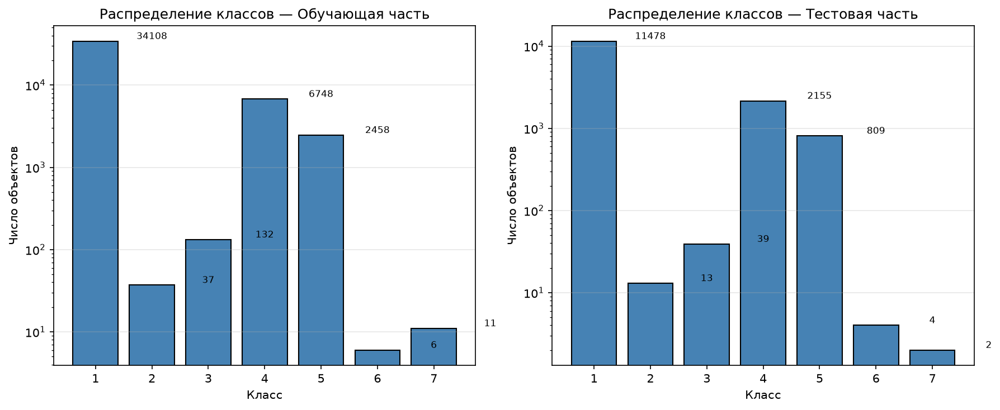


### 6.2 Сравнение алгоритмов — столбчатая диаграмма macro-F1 по кросс-валидации

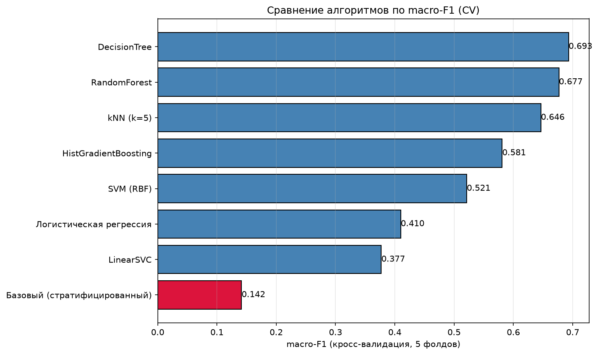


### 6.3 Дерево решений: ошибка от max_depth

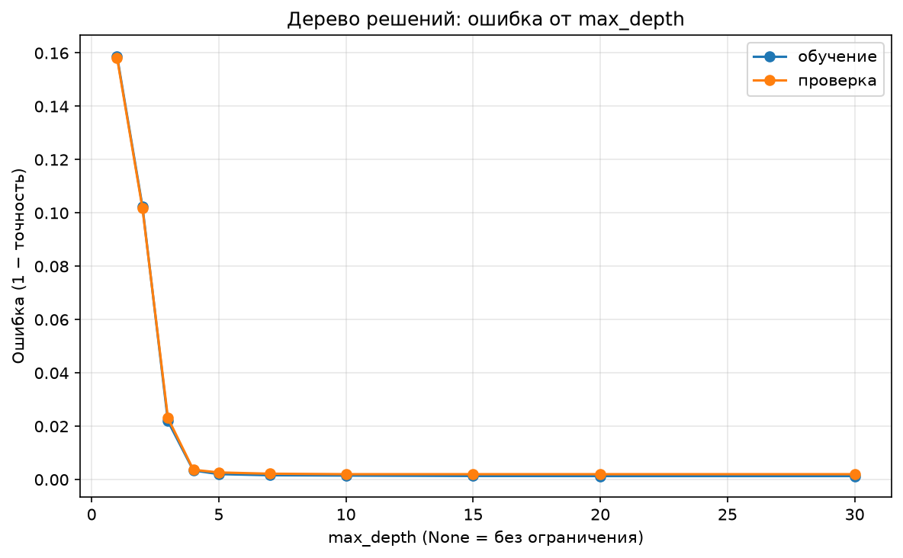


### 6.4 Дерево решений: ошибка от min_samples_leaf

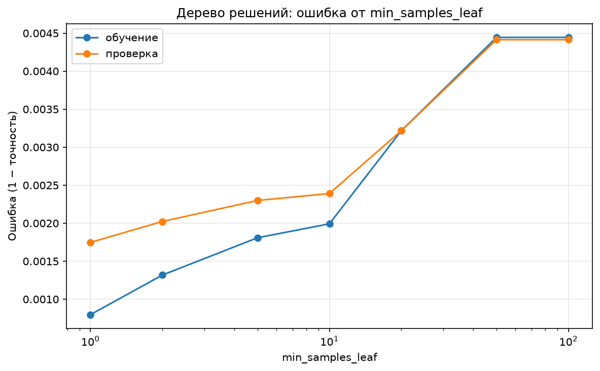


### 6.5 Случайный лес: ошибка и разброс от числа деревьев

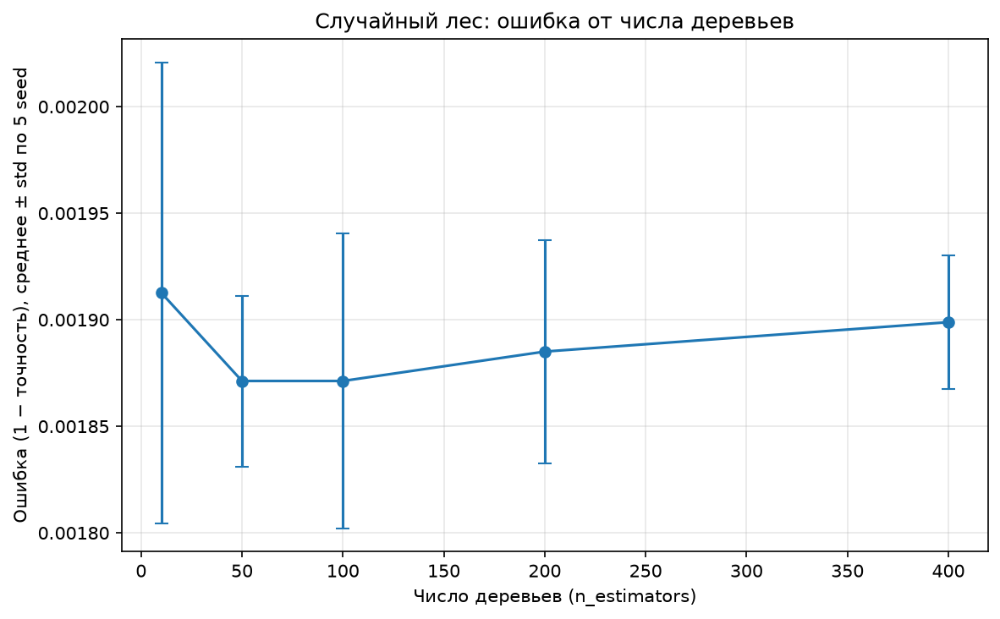


### 6.6 Градиентный бустинг: ошибка от числа итераций (learning_rate = 0.05)

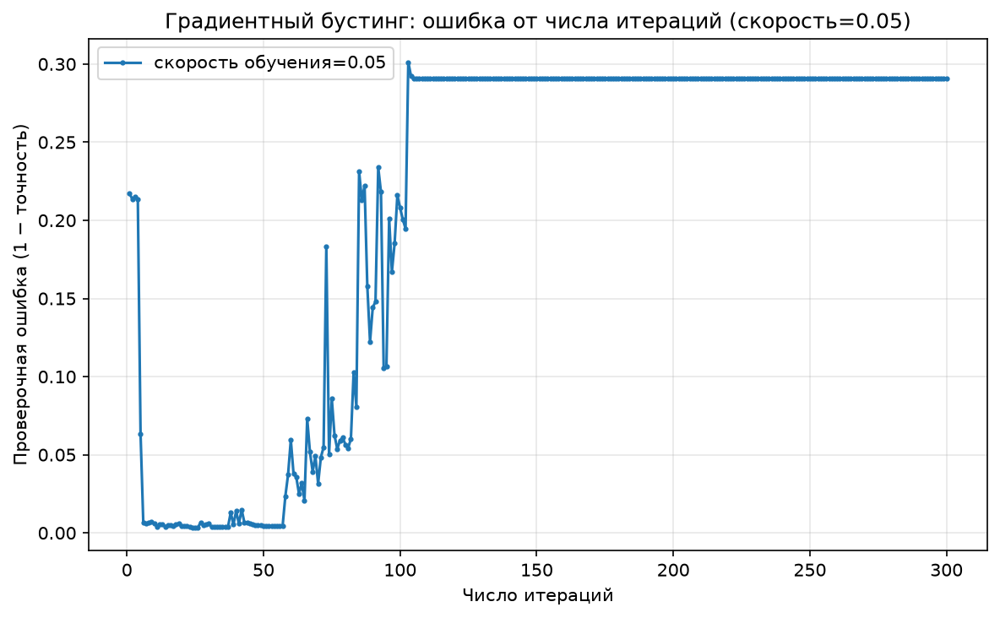


### 6.7 Градиентный бустинг: ошибка от числа итераций (learning_rate = 0.2)

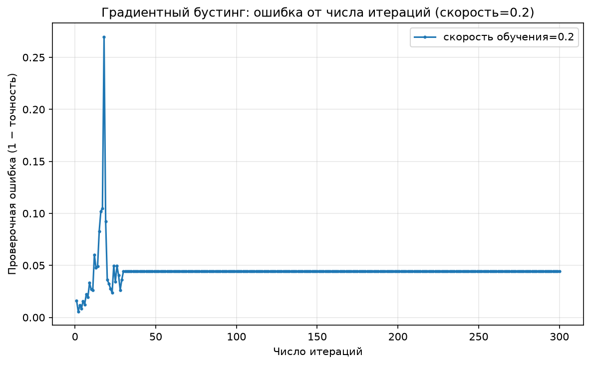


### 6.8 RandomForest: карта макро-F1 по гиперпараметрам (CV)

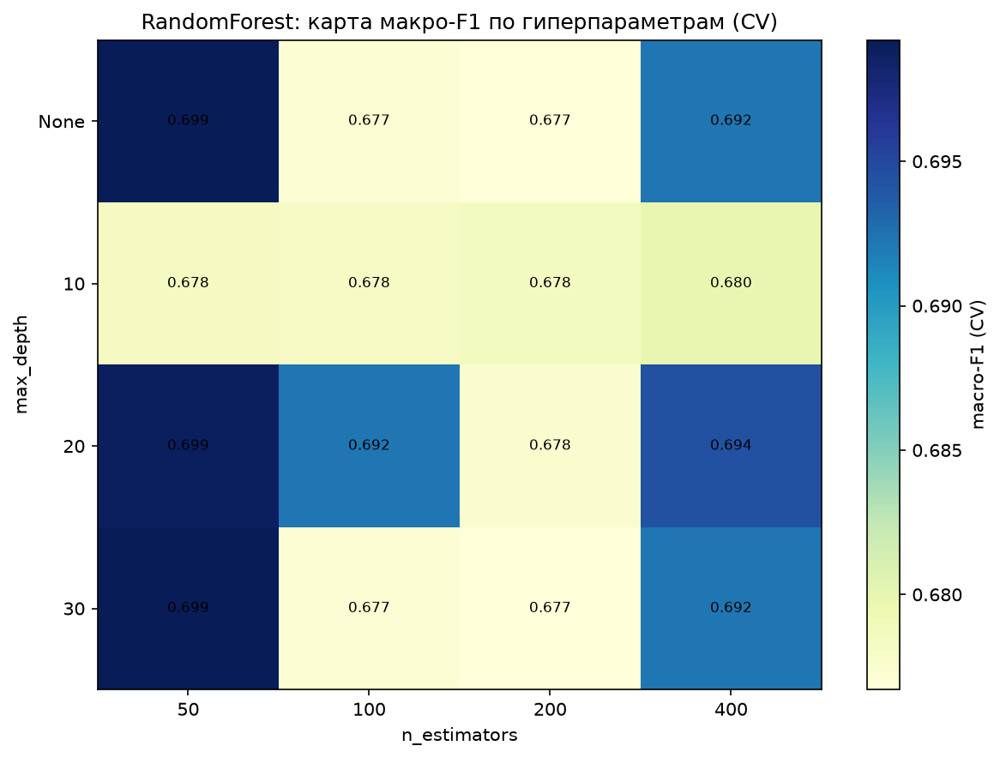


### 6.9 Нормированная матрица ошибок — RandomForest (best GS)

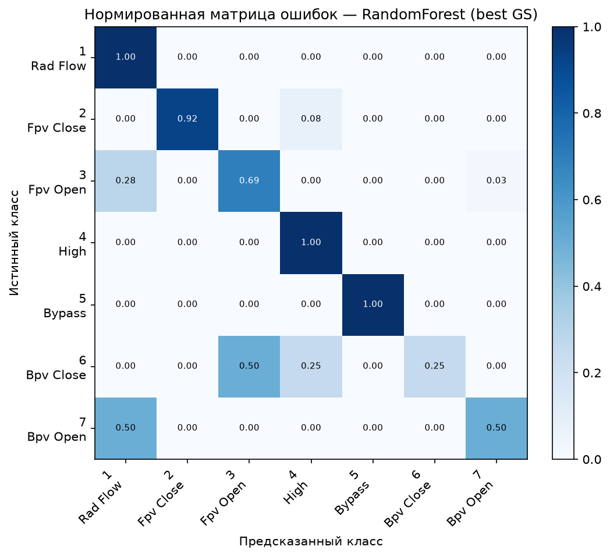


### 6.10 Нормированная матрица ошибок — HistGradientBoosting (best GS)

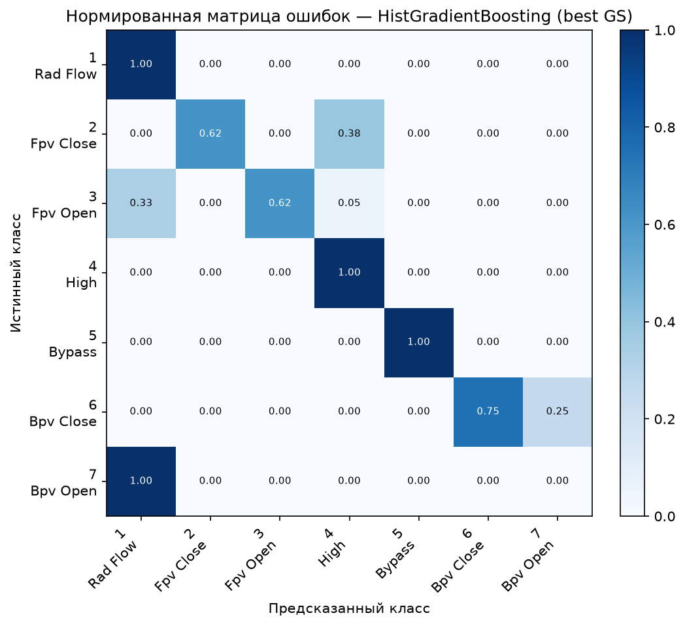


### 6.11 Нормированная матрица ошибок — LogReg

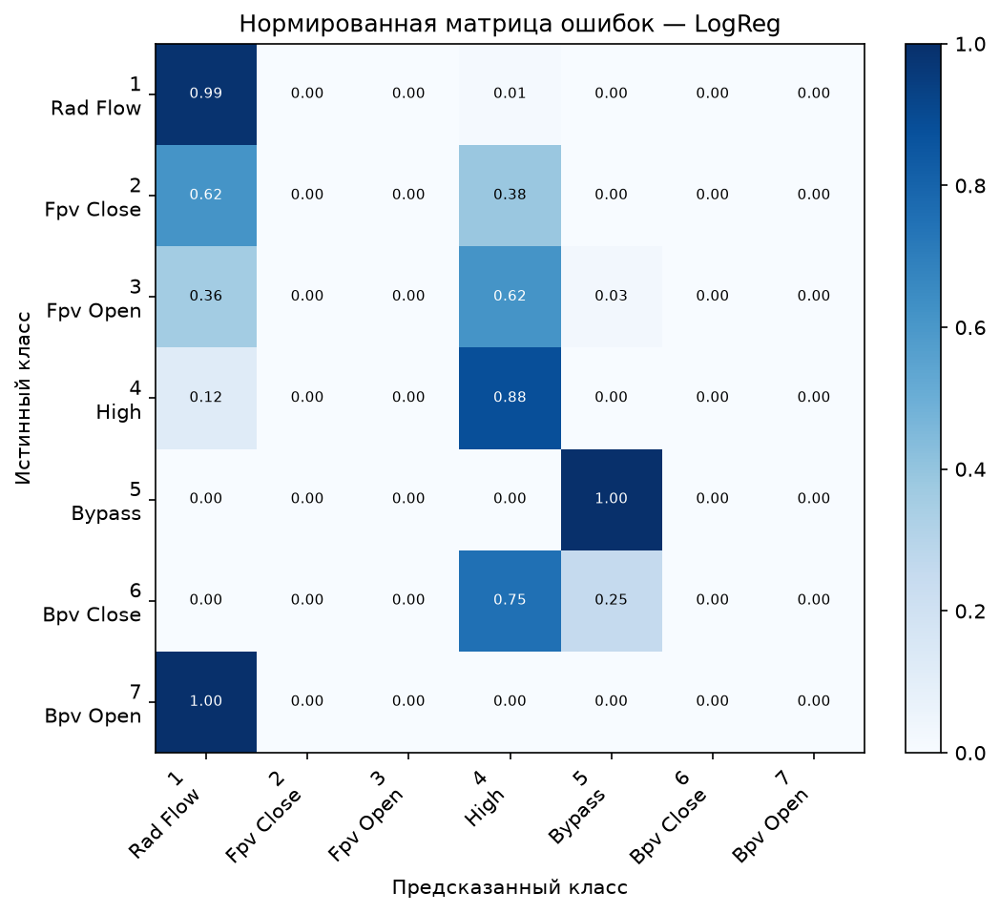


### 6.12 Нормированная матрица ошибок — Dummy (stratified)

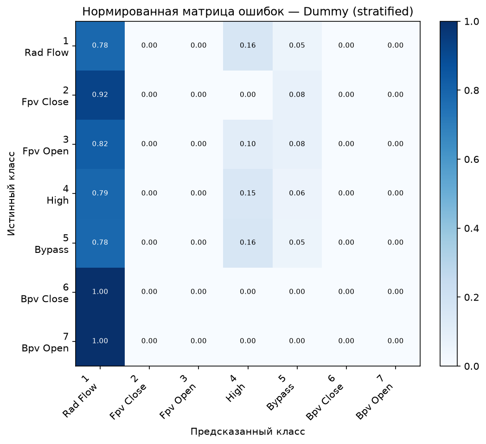


### 6.13 ROC-кривые основных моделей (OvR, макро)

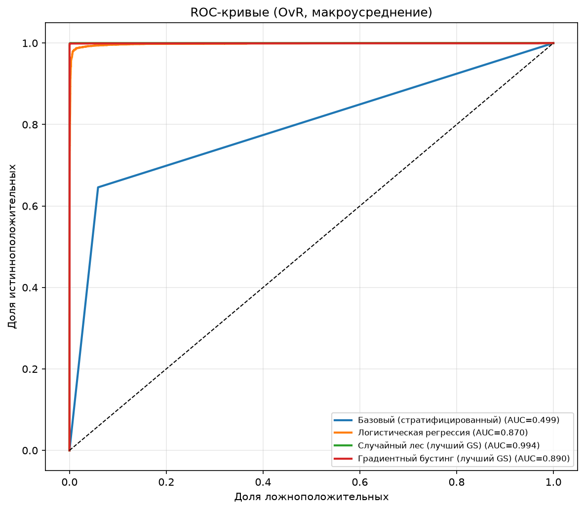


### 6.14 Precision-Recall кривые по классам

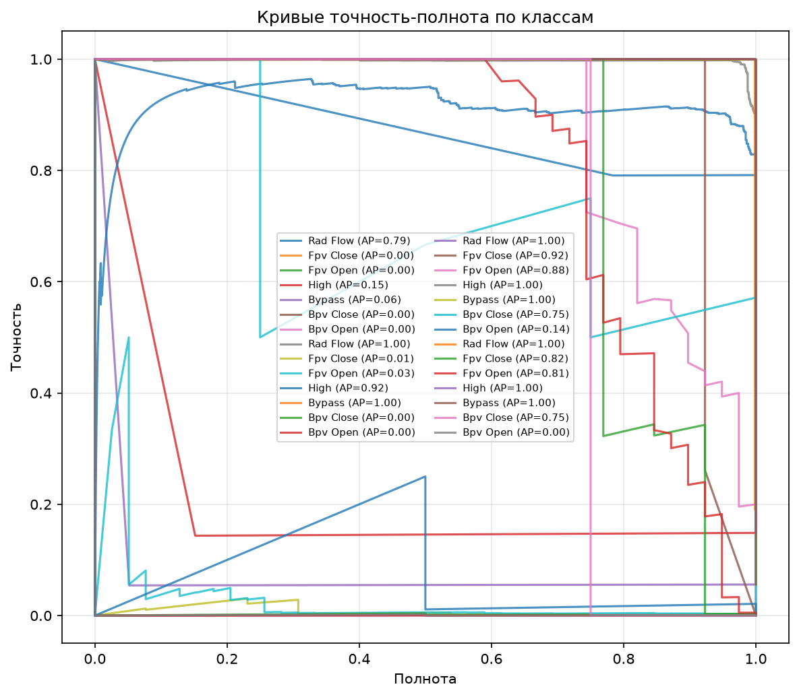

---

## 7. Исследовательский результат

Показано, какие редкие классы модели различают и какие смешиваются с большими классами. Объяснено, почему при точности выше 99 % macro-F1 может оставаться существенно ниже (редкие классы вносят большой вклад в макроусреднение, но мало влияют на общую точность из-за малого числа примеров).

---

## 8. Структура архива `st117207_2.zip`

```
st117207_2/
  load_data.py          # загрузка UCI Statlog (Shuttle) через ucimlrepo
  train.py              # обучение и оценка всех классификаторов
  build_report.py       # воспроизводимая сборка report.pdf
  data/                 # загруженные и разделённые данные
    shuttle_train.csv   # обучающая часть (43500 объектов)
    shuttle_test.csv    # тестовая часть (14500 объектов)
    shuttle_all.csv     # все данные (58000 объектов)
  figure/               # все графики (по одному на страницу в PDF)
    class_distribution.png
    algorithm_comparison.png
    tree_max_depth.png
    tree_min_samples_leaf.png
    forest_n_estimators.png
    boosting_lr0.05.png
    boosting_lr0.2.png
    rf_hyperparam_heatmap.png
    confusion_*.png
    roc_curves.png
    pr_curves.png
  results/              # метрики
    cv_metrics.csv
    test_metrics.csv
    grid_search.json
  fonts/                # шрифт Arial с кириллицей
  tools/pandoc/         # pandoc для конвертации MD → HTML
  REPORT.md             # этот отчёт
  report.pdf            # итоговый PDF (результат build_report.py)
  report.html           # промежуточный HTML
```

---

## 9. Воспроизводимость отчёта (ГОСТ 7.32-2017)

Итоговый `report.pdf` собирается автоматически из `REPORT.md` одной командой:

```bash
python build_report.py
```

Скрипт `build_report.py` выполняет чтение исходных данных, подстановку метрик и таблиц, вставку рисунков из папки `figure/` и сборку PDF через `pandoc` + `xhtml2pdf`. Все зависимости (pandoc, шрифт Arial с кириллицей) включены в архив в папках `tools/` и `fonts/`. Проверяющий может удалить производные файлы (`report.pdf`, `report.html`) и повторить расчёт одной командой. Ручная подмена чисел и изображений в отчёте не допускается. Оформление выполнено по ГОСТ 7.32-2017.