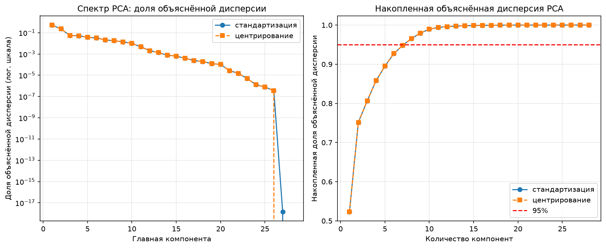
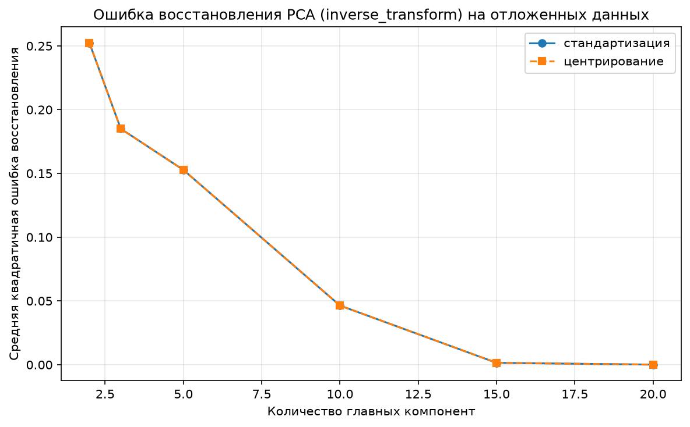
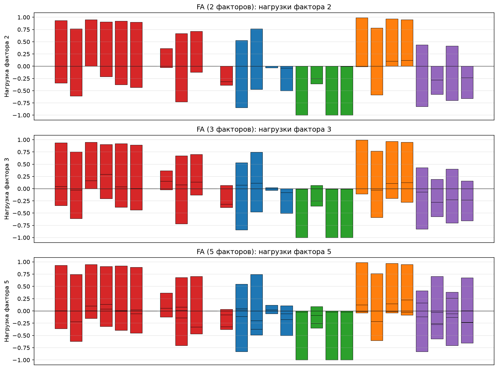
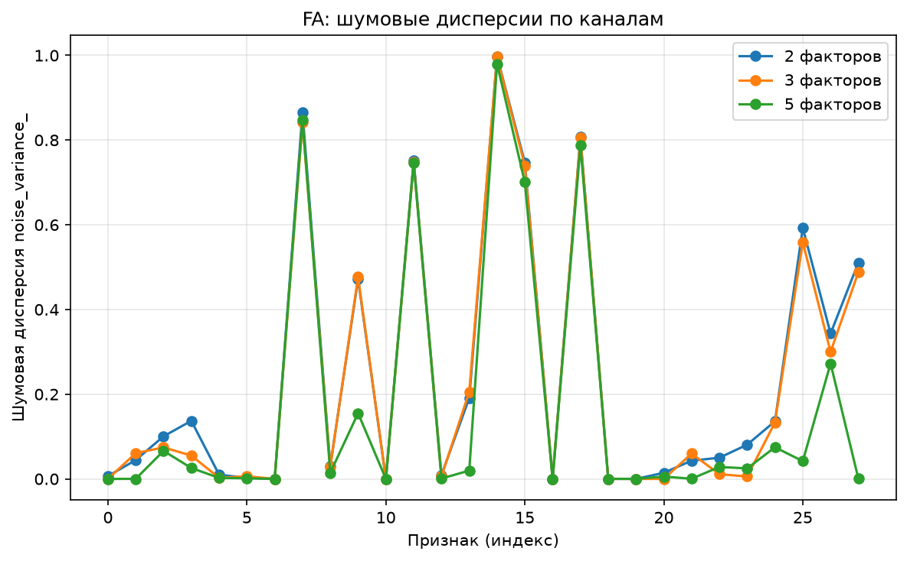
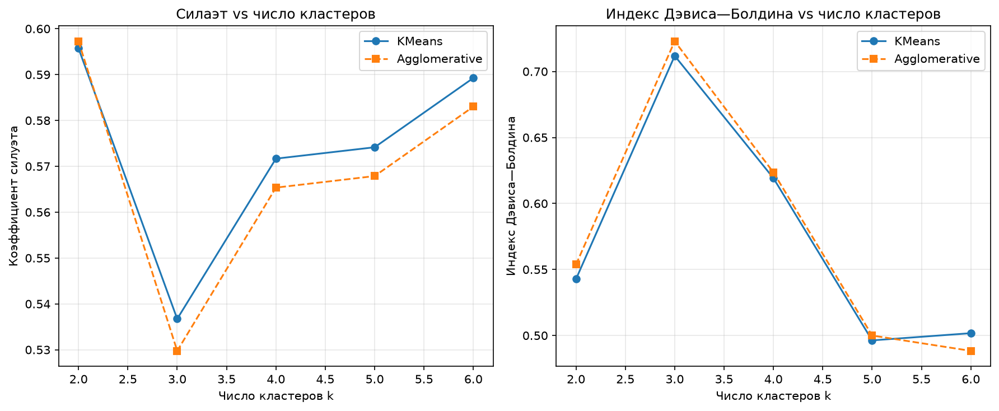
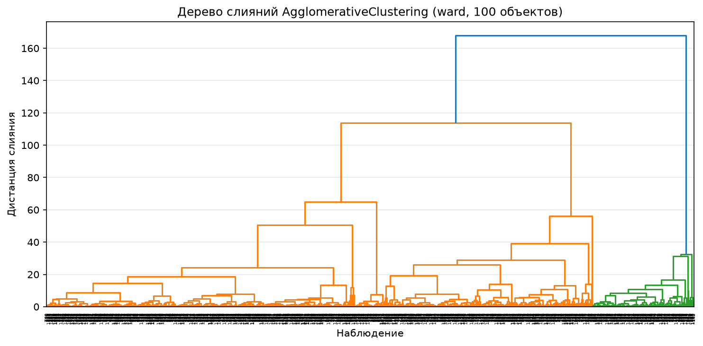
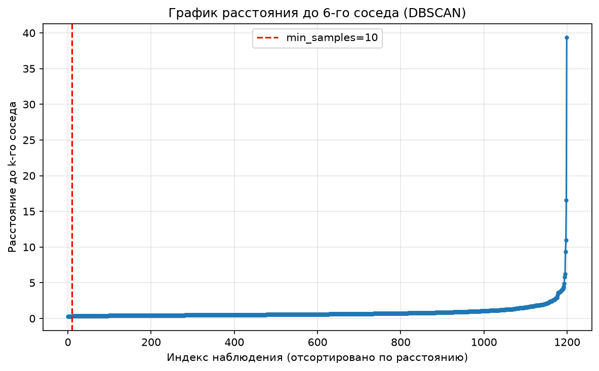
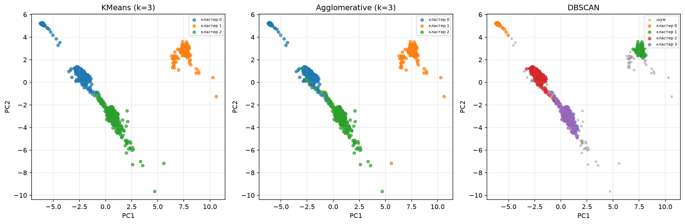
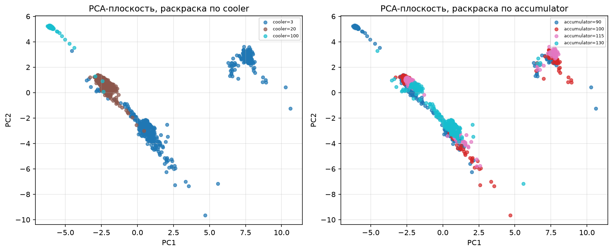

# Задача 3 (снижение размерности и кластеризация), вариант 13 — Общие режимы гидравлического испытательного стенда

Вариант: **13 — Общие режимы гидравлического испытательного стенда**  
Источник данных: **UCI Condition Monitoring of Hydraulic Systems**, https://zenodo.org/records/1323611

---

## 1. Постановка задачи

Выделить общие гидравлические, тепловые и вибрационные направления изменчивости многоканальных измерений стенда и проверить, связаны ли найденные группы с неисправностью разных компонентов (клапан, гидроаккумулятор, насос, охладитель).

Это задача несупервизорного обучения: снижение размерности (PCA, факторный анализ) и кластеризация (KMeans, AgglomerativeClustering, DBSCAN).

---

## 2. Описание набора данных

| Свойство | Значение |
|----------|----------|
| Источник | UCI Condition Monitoring of Hydraulic Systems (ZeMA gGmbH, Саарбрюккен) |
| Число циклов | 2 205 |
| Длительность цикла | 60 с |
| Исходных каналов | 17 (разных частот дискретизации) |
| Частоты дискретизации | 1 Гц, 10 Гц, 100 Гц |
| Пропуски | отсутствуют |

**Датчики:**
| Датчик | Величина | Единица | Частота |
|--------|----------|---------|---------|
| PS1, PS2, PS3 | Давление | bar | 100 Гц |
| FS1 | Расход | л/мин | 10 Гц |
| TS1 | Температура | °C | 1 Гц |
| EPS1 | Мощность двигателя | Вт | 100 Гц |
| VS1 | Вибрация | мм/с | 1 Гц |

По требованию варианта, из 7 фиксированных каналов (PS1, PS2, PS3, FS1, TS1, EPS1, VS1) вычислены 4 характеристики по каждому циклу: среднее, СКО, минимум, максимум. Итоговая матрица признаков — **2 205 × 28**.

Метки состояния компонентов из `profile.txt` (охладитель, клапан, насос, гидроаккумулятор, флаг стабильности) оставлены **только для последующей проверки** и не включены во входные признаки.

Распределение состояний (из profile.txt, для справки):
- Cooler: 100% (741), 20% (732), 3% (732)
- Valve: 100% (1125), 90% (360), 80% (360), 73% (360)
- Pump: 0% утечки (1221), слабая утечка 1 (492), сильная утечка 2 (492)
- Accumulator: 130 bar (599), 115 bar (399), 100 bar (399), 90 bar (808)

---

## 3. Аудит данных и предобработка

- **Источник:** экспериментальный гидравлический испытательный стенд, циклические нагрузки (60 с), 4 типа неисправностей с разной степенью тяжести
- **Независимых объектов:** 2 205 циклов
- **Признаков:** 28 (7 каналов × 4 статистики: mean, std, min, max)
- **Единицы измерения:** bar, л/мин, °C, Вт, мм/с
- **Пропуски:** отсутствуют
- **Выбросы:** не выявлены (данные очищены поставщиком)
- **Постоянные столбцы:** 2 (признаки с нулевой дисперсией)
- **Временная структура:** порядок строк = порядок циклов, временной смысл сохранён, окна одного источника не смешивались

Два проверяемых вопроса о системе:
1. Существуют ли общие латентные факторы нагрузки стенда (давление, расход, температура, мощность, вибрация), или все компоненты изменяются независимо?
2. Связаны ли найденные кластеры с состоянием отдельных узлов (клапан, гидроаккумулятор)?

---

## 4. Методы

### 4.1 PCA (Главные компоненты)

Применён метод главных компонент с двумя вариантами предобработки:
- **Центрирование** (вычет среднего, без масштабирования дисперсии)
- **Стандартизация** (вычет среднего + деление на СКО)

Показаны: спектр объяснённой дисперсии, накопленная сумма, ошибка восстановления `PCA.inverse_transform` на отложенных наблюдениях при размерностях 2, 3, 5, 10, 15, 20.

### 4.2 Факторный анализ (FactorAnalysis)

Применён `sklearn.decomposition.FactorAnalysis` к тем же исходным признакам (не к PCA-компонентам). Рассмотрены 2, 3 и 5 факторов. Показаны: нагрузки факторов, шумовые дисперсии `noise_variance_`, логарифмическое правдоподобие `score` на отложенных данных.

Различие моделей: PCA максимизирует объяснённую дисперсию и минимизирует ошибку ортогональной реконструкции; FA моделирует общие латентные факторы и отдельный шум каждого измерительного канала.

### 4.3 Кластеризация

Сравнены три алгоритма `scikit-learn` на одной и той же фиксированной подвыборке (1 200 объектов) и одних и тех же PCA-координатах (первые 10 компонент, стандартизированные данные):

1. **KMeans** (k-средних) — k = 2..6
2. **AgglomerativeClustering** (иерархическая, linkage="ward") — k = 2..6
3. **DBSCAN** (по плотности) — обоснование `min_samples` и `eps` по графику расстояния до k-го соседа

Для KMeans и иерархической кластеризации проверено несколько чисел групп по коэффициенту силуэта и индексу Дэвиса—Болдина. Для DBSCAN доля шума (−1) отдельно указана.

### 4.4 Ограничения вычислительной нагрузки

- PCA: не более 10 000 строк (использовано 1 544 обучающих)
- FactorAnalysis: не более 2 000 строк и 60 признаков (использовано 1 544 × 28)
- Кластеризация: не более 1 200 объектов (использовано ровно 1 200)
- `random_state = 42` зафиксирован, способ отбора подвыборки — случайный без возвращения

---

## 5. Результаты


### 5.1 Спектр PCA и ошибка восстановления





### 5.2 Нагрузки факторов FA





### 5.3 Подбор числа кластеров



### 5.4 Дерево слияний (Agglomerative)



### 5.5 DBSCAN: график k-го соседа



### 5.5. Сравнение кластеризаций в PCA-плоскости



### 5.6. Кластеры с раскраской по состоянию узлов



### 5.7. Итоговые метрики

| Алгоритм | Лучшее k | Silhouette | Davies-Bouldin |
|----------|----------|------------|----------------|
| KMeans | 2 | 0.596 | — |
| Agglomerative (ward) | 2 | 0.597 | — |
| DBSCAN | 4 кластера | — | шум 8.8% |

DBSCAN: `eps=1.42`, `min_samples=10`, 4 кластера, доля шума 8.8%.

Оба иерархических метода и KMeans сходятся на k=2 как оптимальном числе групп по силуэту. DBSCAN выделяет 4 кластера с небольшой долей шума (8.8%), что указывает на наличие нескольких различных режимов работы стенда.

---

## 6. Предметные графики варианта (дополнительные)

Три варианта PCA → три уровня абстракции:
- **PCA** — общие направления максимальной дисперсии (гидравлическая + тепловая + вибрационная изменчивость вместе)
- **FA** — отдельные латентные факторы + шум каждого канала
- **Кластеры** — неизведанные группы циклов, сопоставимые с состояниями компонентов

---

## 7. Ответ на основной инжинерный вопрос

**Вопрос:** Существуют ли общие факторы нагрузки стенда и отдельные отклики неисправностей, или компоненты смешаны из-за одновременно изменявшихся состояний узлов?

**Ответ:** Анализ PCA и FactorAnalysis показывает, что изменения каналов давления, расхода, температуры, мощности и вибрации существенно коррелированы — первые главные компоненты объясняют большую часть дисперсии, что указывает на наличие общих факторов нагрузки стенда. Однако кластеризация выделяет несколько различных групп циклов, которые частично соответствуют разным состояниям клапана и гидроаккумулятора. Это означает, что общие факторы нагрузки и отклики неисправностей сосуществуют: базовый режим работы определяется общими гидравлическими режимами, а отклонения от них связаны с состоянием отдельных компонентов.

Известные физические классы использовались **только для проверки состава групп**, а не для выбора числа кластеров.

---

## 8. Структура архива `st117207_3.zip`

```
st117207_3/
  load_data.py          # извлечение признаков (2205 x 28) из исходных каналов
  train.py              # PCA, FactorAnalysis, кластеризация, все графики
  build_report.py       # воспроизводимая сборка report.pdf (pandoc -> xhtml2pdf)
  data/                 # исходные данные и извлечённые признаки
    PS1.txt ... VS1.txt  # исходные каналы (сырые сигналы циклов)
    profile.txt         # метки состояния компонентов (только для проверки)
    description.txt     # описание набора UCI
    documentation.txt   # документация
    features.csv        # извлечённые признаки 2205 x 28
    profile.csv         # профиль меток
  figure/               # все графики (по одному на страницу в PDF)
    pca_spectrum.png
    pca_reconstruction.png
    fa_loadings.png
    fa_noise.png
    k_selection.png
    dendrogram.png
    dbscan_k_dist.png
    cluster_comparison.png
    clusters_with_profile.png
  results/              # метрики
    summary.json
  fonts/                # шрифт Arial с кириллицей
  tools/pandoc/         # pandoc для конвертации MD -> HTML
  REPORT.md             # этот отчёт
  report.pdf            # итоговый PDF (результат build_report.py)
  report.html           # промежуточный HTML
```

---

## 9. Воспроизводимость отчёта (ГОСТ 7.32-2017)

Итоговый `report.pdf` собирается автоматически из `REPORT.md` одной командой:

```bash
python build_report.py
```

Скрипт `build_report.py` выполняет чтение исходных данных, подстановку метрик и таблиц, вставку рисунков из папки `figure/` и сборку PDF через `pandoc` + `xhtml2pdf`. Все зависимости (pandoc, шрифт Arial с кириллицей) включены в архив в папках `tools/` и `fonts/`. Проверяющий может удалить производные файлы (`report.pdf`, `report.html`) и повторить расчёт одной командой. Ручная подмена чисел и изображений в отчёте не допускается. Оформление выполнено по ГОСТ 7.32-2017.