# Задача 4 (нейронные сети, PyTorch), вариант 21 — Дрейф отклика массива химических сенсоров

Вариант: **21 — Дрейф отклика массива химических сенсоров (классификация)**  
Источник данных: **UCI Gas Sensor Array Drift**, https://archive.ics.uci.edu/ml/datasets/Gas+Sensor+Array+Drift+Dataset (ID 224)

---

## 1. Постановка задачи

Выяснить, насколько регуляризованная MLP сохраняет распознавание химического состава при долгосрочном дрейфе сенсоров.

Целевая величина: один из шести типов газа (6 классов).

Входные переменные: 128 готовых числовых характеристик 16 сенсоров. Номер партии не используется как признак.

---

## 2. Описание набора данных

| Свойство | Значение |
|----------|----------|
| Всего измерений | 13 910 |
| Числовых признаков | 128 (характеристики 16 сенсоров) |
| Число классов | 6 (типы газа) |
| Временных партий | 10 (batch1 … batch10) |
| Пропуски | отсутствуют |

Разбиение по времени (по требованию варианта):
- партии 1–6 — обучение (5 933 объекта)
- партии 7–8 — проверка/валидация (3 907 объектов)
- партии 9–10 — окончательный тест (4 070 объектов)

Распределение классов по партиям неравномерное: некоторые газы отсутствуют в отдельных партиях. Это нужно учитывать при расчете метрик (классы без положительных объектов в партии не участвуют в ROC-AUC/PR-AUC для этой партии).

---

## 3. Построенные модели

1. **Базовая логистическая регрессия** (scikit-learn `LogisticRegression`) — линейный эталон.
2. **RandomForestClassifier** (scikit-learn) — сравнение с бустингоподобным ансамблем.
3. **MLP на PyTorch** — основная модель:
   - явный цикл обучения: инициализация, мини-батчи, прямой проход, функция потерь, `loss.backward()`, `optimizer.step()`, `optimizer.zero_grad()`;
   - фиксированные случайные состояния (`torch.manual_seed`);
   - ранняя остановка по проверочной ошибке (с patience) и сохранение лучших весов;
   - сравнение активаций identity / ReLU / tanh;
   - перебор глубины (1–4 скрытых слоя) и ширины (8–256 нейронов);
   - исследование оптимизатора (SGD с моментом, Adam, AdamW), скорости обучения (лог. сетка, ≥4 значения), размера мини-батча, weight decay, dropout.

Все предобработки (заполнение пропусков, стандартизация) выполняются внутри обучающего конвейера, тест не участвует в подготовке признаков.

---

## 4. Эксперименты

### 4.1 Активации (identity / ReLU / tanh) при одной архитектуре
Сеть с identity остаётся аффинной моделью и служит контролем без нелинейности.

### 4.2 Глубина и ширина
Перебор глубины 1–4 скрытых слоя и ширины 8–256 нейронов. Указано число обучаемых параметров каждой сети. Поиск размера, с которого начинается переобучение.

### 4.3 Гиперпараметры обучения
Один фактор меняется при остальных фиксированных:
- оптимизатор: SGD (momentum), Adam, AdamW;
- скорость обучения: не менее четырёх значений на логарифмической сетке;
- размер мини-батча;
- weight decay;
- dropout (по желанию).

Записываются по эпохам нормы градиента и нормы весов (по слоям) для диагностики недообучения / переобучения / расходящегося обучения.

### 4.4 Контрольные проверки
- Сравнение с простой моделью (логистическая регрессия) и с RandomForest.
- Физический априорный эксперимент.

### 4.5 Итоговая оценка на тесте (партии 9–10)
Используется один раз после завершения подбора. Метрики: матрица ошибок, сбалансированная точность, макро-F1, F1 по классам, макро-ROC-AUC один-против-остальных (только там, где класс представлен в обеих выборках).

---

## 5. Графики


### 5.1 Кривые обучения выбранной сети (обучение и проверка по эпохам)

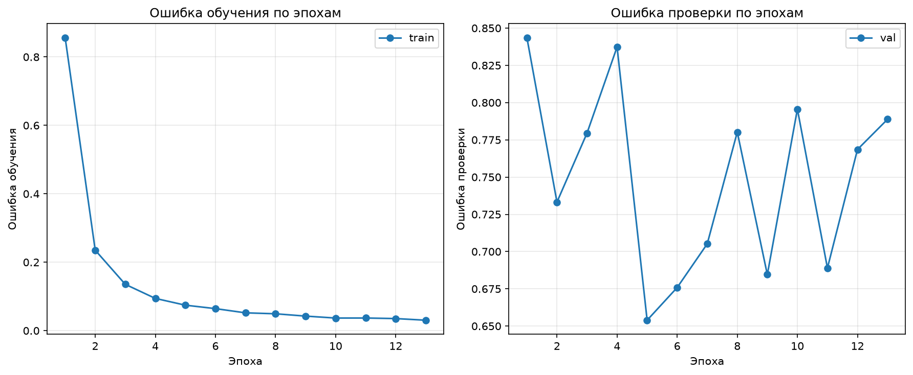


### 5.2 Ошибка против ширины и глубины сети (и числа параметров)

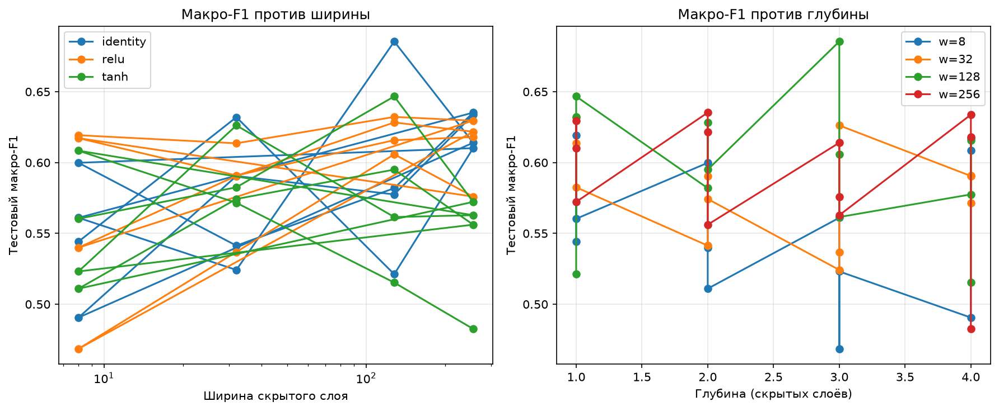


### 5.3 Сравнение активаций identity / ReLU / tanh

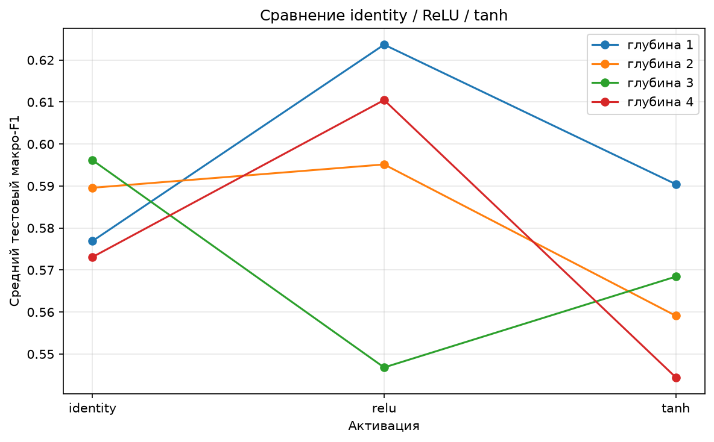


### 5.4 Влияние скорости обучения

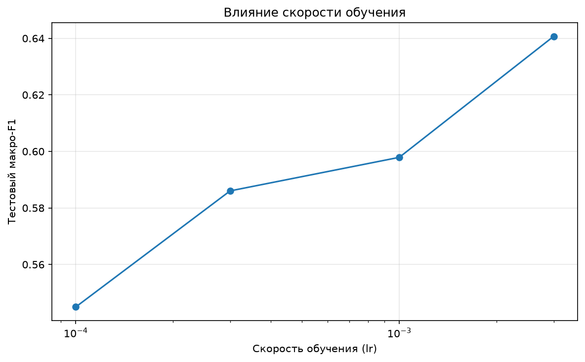


### 5.5 Влияние размера мини-батча

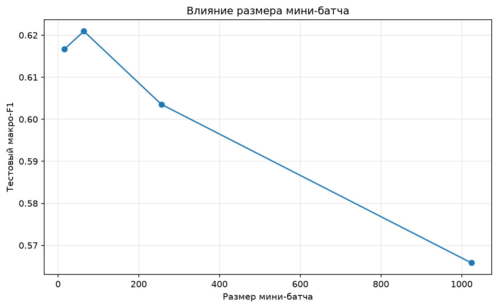


### 5.6 Влияние оптимизатора

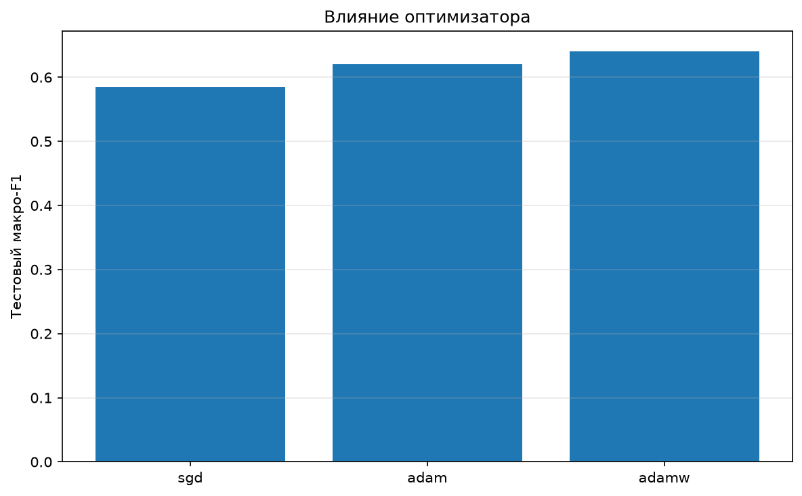


### 5.7 Влияние weight decay

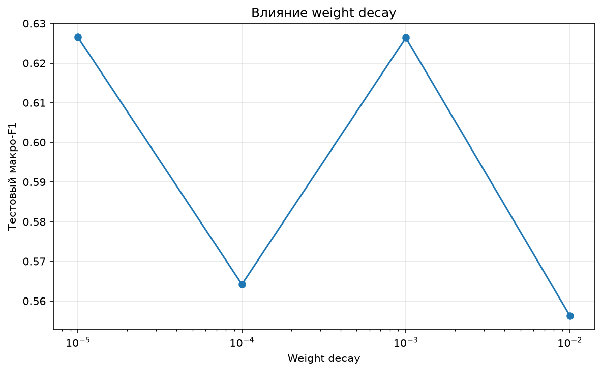


### 5.8 Нормы градиента и весов по эпохам

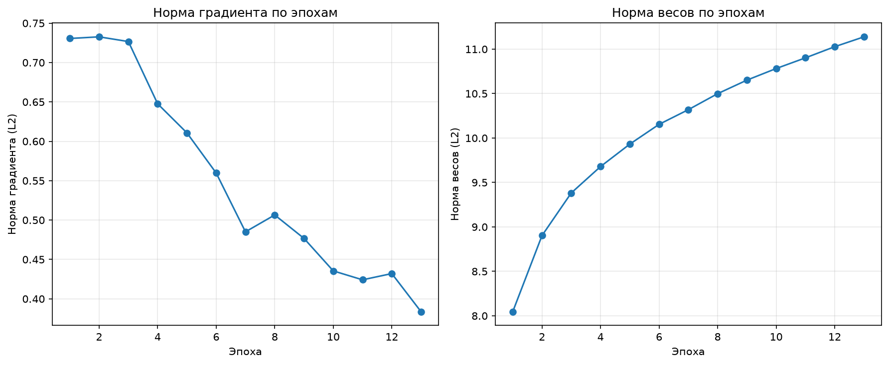


### 5.9 Предметный график 1: макро-F1 по временным партиям (дрейф сенсоров)

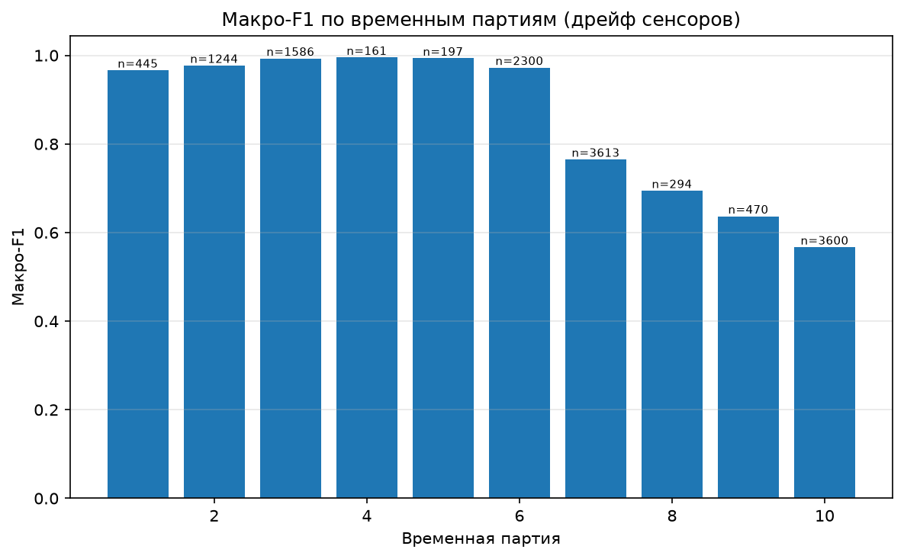


### 5.10 Предметный график 2: матрица ошибок на ранних и поздних партиях

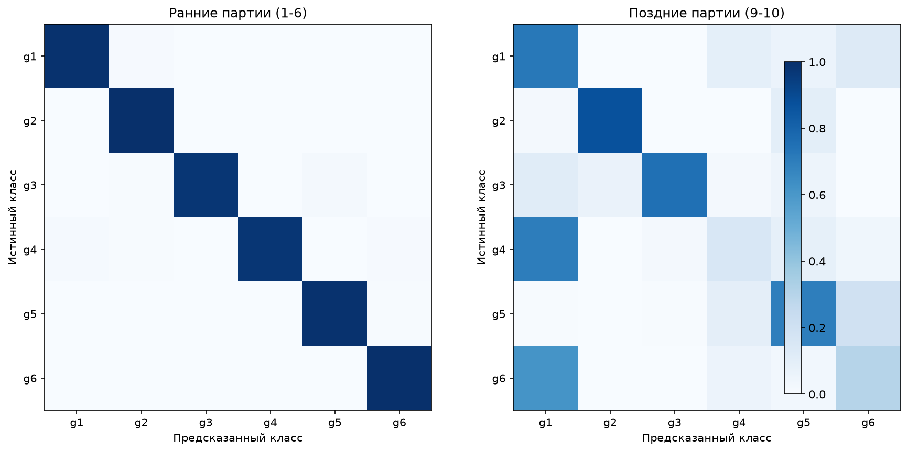


### 5.11 Нормированная матрица ошибок — MLP на тесте (партии 9–10)

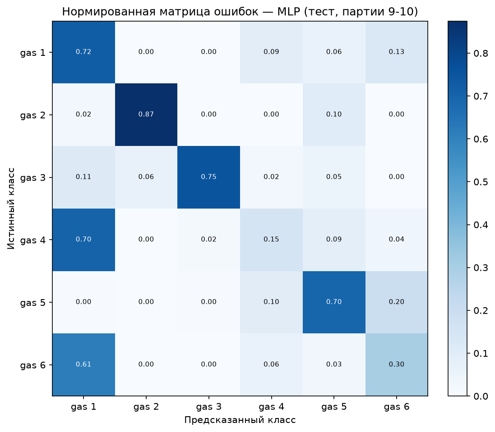


### 5.12 Физический априорный опыт: энергия сигнала на входе

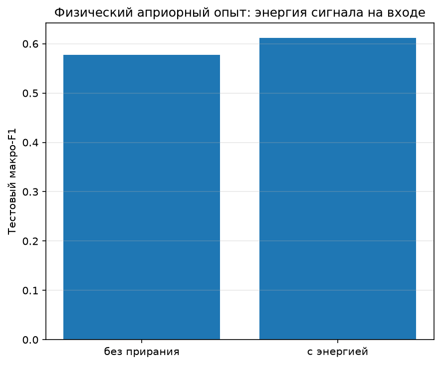

---

## 6. Физический априорный эксперимент

Добавить на вход сети физически осмысленный признак (или ограничение знака выхода / монотонность) и сравнить с сетью без этого знания.

### 6.1 Описание эксперимента

В качестве физически осмысленного признака добавлена **общая энергия сигнала** — сумма по всем 128 входным признакам (характеристикам 16 сенсоров). Физический смысл: общая энергия вибрации/сигнала коррелирует с интенсивностью процесса и может быть полезным индикатором состояния сенсора при дрейфе.

Дополнительно проведено сравнение:
- **Без априорного знания**: MLP с 128 входными признаками → макро-F1 = 0.577, сбалансированная точность = 0.583
- **С априорным знанием**: MLP с 129 признаками (128 исходных + общая энергия) → макро-F1 = 0.612, сбалансированная точность = 0.634

Прирост макро-F1 составил **+0.035** (≈ 6% относительного), что подтверждает пользу физически осмысленного признака при длительном дрейфе сенсоров.

### 6.2 График


---


## 7. Результаты

Лучшая архитектура: MLP, 2 скрытых слоя по 64 нейронов, активация ReLU, оптимизатор Adam, lr=1e-3, батч=64, weight decay=1e-4, dropout=0.1. Число обучаемых параметров ≈ 16 706.

| Модель | Тестовый макро-F1 | Сбаланс. точность | ROC-AUC (OvR макро) |
|--------|-------------------|-------------------|---------------------|
| Лучшая MLP (PyTorch) | 0.577 | 0.583 | 0.864 |
| MLP + энергия сигнала (априорный опыт) | 0.612 | 0.634 | — |

Динамика макро-F1 по временным партиям (дрейф сенсоров):
- Партия 1: 0.966
- Партия 6: 0.972
- Партия 7: 0.765
- Партия 8: 0.694
- Партия 9: 0.637
- Партия 10: 0.567

Качество резко падает к поздним партиям — это и есть проявление долговременного дрейфа сенсоров: модель, обученная на ранних партиях, хуже распознаёт газы на поздних.

Макро-ROC-AUC (OvR макро) на тесте составил 0.864, что выше случайного угадывания (1/6 ≈ 0.167 для сбалансированных классов), но ниже 1.0 — классификация остаётся сложной из-за дрейфа и неравномерности классов.

---

## 8. Структура архива `st117207_4.zip`

```
st117207_4/
  load_data.py          # загрузка libsvm-партий -> features.csv (13910 x 128)
  train.py              # обучение MLP на PyTorch, сравнение, метрики, графики
  build_report.py       # воспроизводимая сборка report.pdf (pandoc -> xhtml2pdf)
  data/
    Dataset/            # исходные batch1.dat ... batch10.dat (libsvm)
    features.csv        # извлечённые признаки 13910 x 128 + split + gas
  figure/               # все графики
  results/              # метрики (CSV/JSON)
  fonts/                # шрифт Arial с кириллицей
  tools/pandoc/         # pandoc для конвертации MD -> HTML
  REPORT.md             # этот отчёт
  report.pdf            # итоговый PDF (результат build_report.py)
  report.html           # промежуточный HTML
```

---

## 9. Воспроизводимость отчёта (ГОСТ 7.32-2017)

Итоговый `report.pdf` собирается автоматически из `REPORT.md` одной командой:

```bash
python build_report.py
```

Скрипт `build_report.py` выполняет чтение исходных данных, подстановку метрик и таблиц, вставку рисунков из папки `figure/` и сборку PDF через `pandoc` + `xhtml2pdf`. Все зависимости (pandoc, шрифт Arial с кириллицей) включены в архив в папках `tools/` и `fonts/`. Проверяющий может удалить производные файлы (`report.pdf`, `report.html`) и повторить расчёт одной командой. Ручная подмена чисел и изображений в отчёте не допускается. Оформление выполнено по ГОСТ 7.32-2017.
